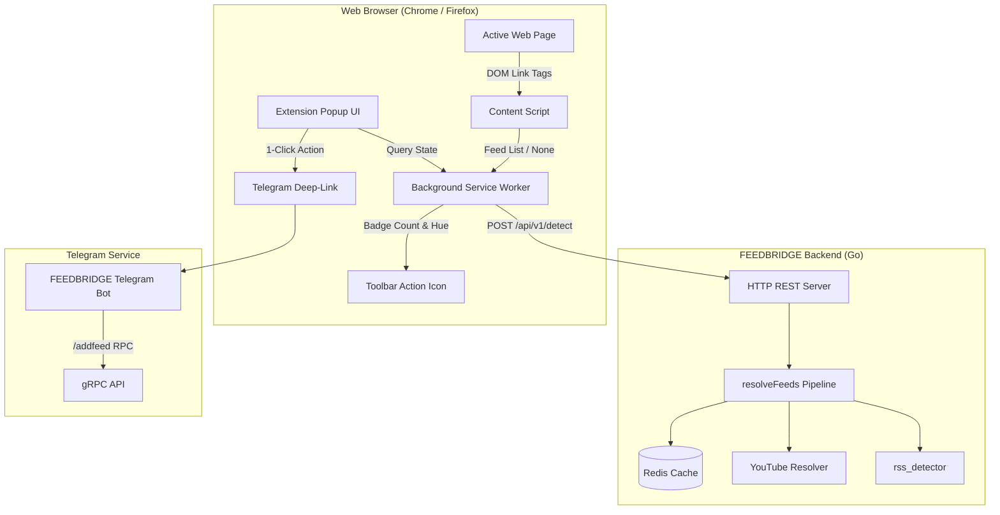

# Requirements

### Overview & Goals
The goal is to develop a lightweight, non-invasive cross-browser extension for **Google Chrome** and **Mozilla Firefox** (Manifest V3) that automatically discovers RSS, Atom, and JSON feeds on active web pages, visualizes feed availability via an unobtrusive toolbar icon badge counter, and empowers users to inspect feeds by type and subscribe in one click to Telegram (and future platforms).

### Scope
- **In Scope**:
  - Manifest V3 compliant extension targeting both Chrome and Firefox from a single codebase.
  - Non-invasive detection: In-page DOM `<link rel="alternate">` discovery supplemented by FEEDBRIDGE backend API fallback for deep detection (YouTube, root fallback, server-cached feeds).
  - Unobtrusive toolbar badge showing feed count and status hue.
  - Popup UI categorizing detected feeds by standard (`RSS`, `Atom`, `JSON Feed`, `XML`).
  - Feed actions: Copy URL to clipboard, open raw feed in browser.
  - Subscribe action: Bot selector screen supporting **Telegram** (`t.me/<bot>?start=...` or `/addfeed` deep link) and placeholders for **Discord** and direct **Web Dashboard** sync.
  - Backend HTTP REST endpoint (`/api/v1/detect`) in Go to interface with the extension.
  - Options page for configuring custom backend endpoint and default subscription bot.
- **Out of Scope (Current Milestone)**:
  - Full OAuth2 / user authentication system for web dashboard (architecture will include extensible stubs for future website sign-in).
  - Discord bot implementation (handled in a separate backend phase).
  - Automated feed reading / full feed reader client within the extension popup.

### User Stories
- **US-1 (Passive Discovery)**: As a user browsing the web, I want the extension to automatically identify if the current page provides feeds without slowing down my browsing or displaying intrusive popups, so that I immediately know when syndication is available.
- **US-2 (Categorized Inspection)**: As a user, I want to click the extension icon to see all available feeds grouped by type (RSS, Atom, JSON, XML) with their titles and URLs, so that I can choose the exact format I need.
- **US-3 (Bot Subscription)**: As a Telegram user, I want to click a "Subscribe via Bot" button on a feed and be redirected to the FEEDBRIDGE Telegram bot with the feed preloaded, so that I can subscribe in seconds without copy-pasting URLs manually.
- **US-4 (Quick Export & Copy)**: As a power user, I want to quickly copy feed links to my clipboard or preview them in a new tab to verify the content.

### Functional Requirements
- **FR-1**: Passive DOM scanning via content script on `document_idle` for `<link rel="alternate" type="...">` tags.
- **FR-2**: Backend fallback detection for platforms requiring specialized resolvers (e.g. YouTube channels, videos, handles) or sites with non-standard feed locations.
- **FR-3**: Badge counter on the extension action icon reflecting the number of detected feeds for the active tab; badge clears or updates when switching tabs or navigating.
- **FR-4**: Popup display categorizing feeds into tabs/sections (`RSS`, `Atom`, `JSON`, `XML`) with title, URL, and format tags.
- **FR-5**: One-click "Copy URL" with visual clipboard confirmation.
- **FR-6**: "Subscribe" flow with platform modal displaying Telegram (active) and placeholders for Discord and Web.
- **FR-7**: Extension settings allowing custom FEEDBRIDGE backend URL configuration (defaulting to production or `localhost:8080`).

### Non-Functional Requirements
- **Performance & Efficiency**: Client-side DOM parsing runs in < 5ms with zero network overhead for standard sites; backend network queries only occur when DOM yields 0 feeds or on explicit request.
- **Cross-Browser Parity**: 100% feature and visual parity between Chrome and Firefox using web extension standards.
- **Privacy & Permissions**: Minimal permission footprint (`activeTab`, `storage`, optional host permissions for backend API). No history logging or user tracking.

# Technical Design

### Current Implementation
- `backend/`: Go server with gRPC services (`SetUrlHandler`, `FeedHandlerService`, `SubscriptionService`), Redis caching, singleflight coalescing, and YouTube resolver (`backend/youtube/`).
- `telegram-bot/`: Telebot v4 bot that communicates with the backend via gRPC and handles `/addfeed <url>`.
- **Gap**: The backend currently only accepts gRPC on `:50051`. Browser extensions cannot communicate directly over raw gRPC; a lightweight HTTP REST endpoint is required for feed resolution.

### Key Decisions
1. **Hybrid Client-DOM + Backend Fallback Architecture**:
   - *Rationale*: Inspecting DOM `<link>` tags in the content script provides instant results for 85%+ of standard blogs/news sites with zero server load or network latency. When 0 feeds are found or on supported media domains (e.g. YouTube), the background script calls the FEEDBRIDGE backend HTTP API which leverages `rss_detector` and Redis caching.
2. **Built-in HTTP REST Endpoint in Go Backend**:
   - *Rationale*: Exposing a clean `/api/v1/detect` JSON endpoint directly in the backend avoids external proxy dependencies and shares the exact same `resolveFeeds` logic and Redis singleflight cache.
3. **WXT / TypeScript Extension Framework**:
   - *Rationale*: WXT compiles standard Manifest V3 for both Chrome and Firefox targets from a single TypeScript codebase, streamlining asset management, polyfills, and packaging.
4. **Deep-Link Bot Subscription Model**:
   - *Rationale*: Provides immediate utility without requiring complex bot authentication by leveraging Telegram deep linking (`https://t.me/<bot>?start=add_<url_hash>` or `https://t.me/<bot>?startgroup=...`), with a modular design ready to incorporate web token authentication once the web dashboard is built.

### Architecture Diagram


### Proposed Changes

#### 1. Backend: HTTP REST Detection Handler
- Implement HTTP server in `backend/` exposing:
  - `POST /api/v1/detect` / `GET /api/v1/detect?url=...`
  - CORS headers enabled for extension origins (`chrome-extension://*`, `moz-extension://*`).
- Reuses `resolveFeeds(ctx, h.YouTube, rawURL)` from `backend/handlers/detect.go`.
- Returns categorized feed items with format classification.

#### 2. Browser Extension: Core & Content Script (`browser-extension/`)
- `manifest.json` (Manifest V3) declaring `activeTab`, `storage`, and action popup.
- `entrypoints/content.ts`: Parses `<link rel="alternate" type="...">` tags from `document.head`, normalizes absolute URLs, and messages the background worker.
- `entrypoints/background.ts`: Maintains a tab-to-feeds registry, triggers HTTP backend detection if DOM detection is empty, and updates `action.setBadgeText` and `action.setBadgeBackgroundColor`.

#### 3. Browser Extension: Popup UI (`entrypoints/popup/`)
- Grouped list view:
  - Categorized under type chips: `RSS (2.0)`, `Atom (1.0)`, `JSON Feed (1.1)`, `XML/Generic`.
  - Copy URL button with animation.
  - "Subscribe" modal opening platform choices:
    - **Telegram**: redirects to configured bot with command / deep link.
    - **Discord**: disabled badge ("Coming Soon").
    - **Web Sync**: placeholder authentication interface for future web release.

#### 4. Browser Extension: Options & Configuration
- Storage-backed settings for custom API URL and Telegram bot username.

### Data Models / Contracts

#### Backend HTTP Contract: `POST /api/v1/detect`
```json
// Request
{
  "url": "https://example.com/blog"
}

// Response
{
  "url": "https://example.com/blog",
  "total": 2,
  "feeds": [
    {
      "url": "https://example.com/blog/feed.xml",
      "title": "Example Blog RSS",
      "type": "rss"
    },
    {
      "url": "https://example.com/blog/atom.xml",
      "title": "Example Blog Atom",
      "type": "atom"
    }
  ]
}
```

#### Extension Internal Tab State Model
```typescript
interface DetectedFeed {
  url: string;
  title: string;
  type: 'rss' | 'atom' | 'json' | 'xml' | 'unknown';
  source: 'dom' | 'backend';
}

interface TabFeedState {
  tabId: number;
  pageUrl: string;
  status: 'idle' | 'scanning' | 'found' | 'none' | 'error';
  feeds: DetectedFeed[];
}
```

### File Structure
```
FEEDBRIDGE/
├── backend/
│   ├── handlers/
│   │   ├── http_detect.go        # HTTP REST handler for feed detection
│   │   └── http_detect_test.go   # REST detection tests
│   └── main.go                   # Multiplex / start HTTP API alongside gRPC
└── browser-extension/
    ├── package.json
    ├── wxt.config.ts             # WXT cross-browser MV3 build config
    ├── tsconfig.json
    ├── entrypoints/
    │   ├── background.ts         # Service worker: badge management & API fallback
    │   ├── content.ts            # Content script: DOM link extraction
    │   ├── popup/                # Popup UI (Categorized list & Subscribe modal)
    │   │   ├── index.html
    │   │   ├── App.tsx
    │   │   └── styles.css
    │   └── options/              # Settings UI (Backend URL, Bot handle)
    │       ├── index.html
    │       └── Options.tsx
    └── utils/
        ├── api.ts                # HTTP client for FEEDBRIDGE backend
        ├── dom.ts                # DOM link tag parser
        └── storage.ts            # Storage wrapper for settings
```

### Risks
- **CORS / Host Permissions**: Extensions calling localhost or remote backend endpoints require `host_permissions` in Manifest V3. *Mitigation*: Declare backend URL pattern in manifest and allow user configuration in options.
- **Single Page Apps (SPAs)**: Dynamic client-side navigation (History API) may not trigger full page reload. *Mitigation*: Background script listens to `webNavigation.onHistoryStateUpdated` to trigger DOM re-scans.
- **Browser Differences in MV3**: Firefox uses event pages while Chrome uses service workers. *Mitigation*: WXT abstracts runtime differences into standard WebExtension lifecycle events.

# Testing

### Validation Approach
Verification combines automated backend HTTP tests, extension unit tests, and cross-browser end-to-end testing with mock web pages containing various feed formats.

### Key Scenarios
1. **Standard Blog with DOM RSS/Atom**:
   - Open page containing `<link rel="alternate" type="application/rss+xml" href="/rss.xml">`.
   - Verify extension badge displays "1" with active hue within 100ms.
   - Open popup: verify item listed under "RSS" category with accurate title and full resolved URL.
   - Click "Copy URL": verify clipboard contains the absolute feed URL.
2. **Page with Multiple Feed Types**:
   - Open page with both Atom (`application/atom+xml`) and JSON Feed (`application/feed+json`).
   - Verify badge displays "2".
   - Verify popup splits items into respective "Atom" and "JSON" sections.
3. **Deep Link / YouTube Channel (Backend Fallback)**:
   - Open a YouTube channel URL (`https://www.youtube.com/@ChannelName`) where DOM `<link>` tags do not expose standard RSS.
   - Verify background script initiates backend API call, resolves feed via YouTube resolver, and populates badge and popup with the Atom feed.
4. **Subscribe to Telegram Bot**:
   - Click "Subscribe" on a detected feed -> select "Telegram".
   - Verify browser opens `https://t.me/<bot_username>?start=...` (or deep-link) with the target feed encoded.
5. **No Feeds Page**:
   - Navigate to page without feeds. Verify badge is empty/hidden, popup displays clear "No feeds found" status with a manual "Scan with Backend" option.

### Edge Cases
- **Relative Feed URLs**: `<link href="/feed.xml">` resolved accurately against `window.location.origin`.
- **Malformed XML / Inaccessible URLs**: Handled gracefully without crash or infinite retry loops.
- **SPA Navigation (e.g. Next.js / React)**: Re-scans correctly upon URL changes without full page reload.
- **Offline / Backend Unreachable**: Extension degrades gracefully to DOM-only detection when backend HTTP API is unreachable.

### Test Changes
- `backend/handlers/http_detect_test.go`: Unit tests for JSON detection endpoint, error codes, and CORS handling.
- `browser-extension/tests/dom.test.ts`: Unit tests verifying link tag extraction across valid/invalid MIME types and relative path resolution.
- `browser-extension/tests/api.test.ts`: Mocked tests for backend HTTP communication.

# Delivery Steps

###   Step 1: Backend HTTP REST Detection API
The backend exposes lightweight HTTP REST endpoints alongside the existing gRPC server for feed detection and link resolution.

- Add an HTTP server mux in `backend/main.go` (or separate HTTP listener) supporting `/api/v1/detect` (POST/GET) and `/api/v1/info`.
- Implement `handlers/http_detect.go` that reuses `resolveFeeds` (`rss_detector` and YouTube resolver), Redis caching with singleflight coalescing, and `LinkRepoService`.
- Return structured JSON containing feed list with explicit metadata (`url`, `title`, `type`: `rss`, `atom`, `json`, `xml`).
- Add CORS middleware to permit browser extension background/content script origins.
- Write unit tests in `handlers/http_detect_test.go` verifying JSON responses and error status mappings.

###   Step 2: Extension Core and Hybrid Detection Pipeline
A cross-browser Manifest V3 extension structure that detects feeds via content script DOM extraction and background worker fallback.

- Set up extension directory `browser-extension/` with WXT / TypeScript configuration targeting both Chrome and Firefox MV3.
- Implement `content.ts` to scan `<link rel="alternate" ...>` DOM tags on document idle, parsing MIME types (`application/rss+xml`, `application/atom+xml`, `application/json`).
- Implement `background.ts` service worker / event page handling tab updates, deduplicating requests, and invoking backend `/api/v1/detect` if DOM extraction yields zero feeds or for dynamic video/channel URLs (e.g., YouTube).
- Manage per-tab feed state in memory / session storage with badge counter and hue updates (`chrome.action.setBadgeText`, `setBadgeBackgroundColor`).
- Implement cross-browser polyfill abstractions for seamless operation on Chrome and Firefox.

###   Step 3: Categorized Popup UI and Badge Visualization
The extension popup displays detected feeds organized by syndication standard with copy, open, and subscribe actions.

- Build the popup interface (`popup/index.html` + `popup/App.tsx`) with categorized tabbed/grouped view: RSS, Atom, JSON, and XML.
- Display feed metadata (Feed title, source URL, format badge, and item count if available).
- Add quick action buttons: One-click "Copy Feed URL" with toast feedback and "Open Feed" in a new browser tab.
- Implement empty state ("No feeds detected on this page") with manual "Re-scan with FEEDBRIDGE backend" trigger.
- Style with a clean, lightweight UI designed for fast loading and zero layout shifts.

###   Step 4: Subscription Flow and Bot Selector Integration
Users can subscribe detected feeds to external bots or prepare for future web dashboard sync.

- Implement the "Subscribe" modal inside the popup featuring a Bot Selection Screen:
  - **Telegram Bot**: Generates deep-link `https://t.me/<bot_username>?start=add_<encoded_feed_url>` or opens direct chat with pre-populated command `/addfeed <url>`.
  - **Discord Bot**: Visual placeholder marked "Coming Soon" with disabled state.
  - **FEEDBRIDGE Web**: UI placeholder for direct cloud sync, with an extensible authentication stub for future web sign-in tokens.
- Add an Options / Settings page allowing users to configure custom backend API URL and default bot preferences.
- Perform end-to-end integration testing across Chrome and Firefox.