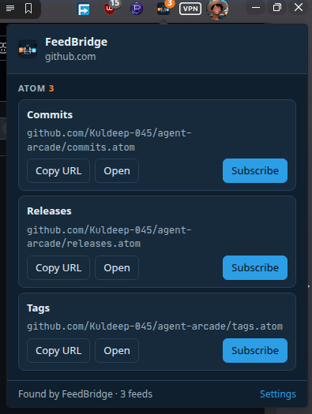
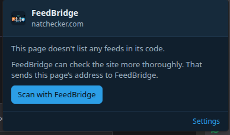
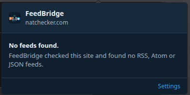
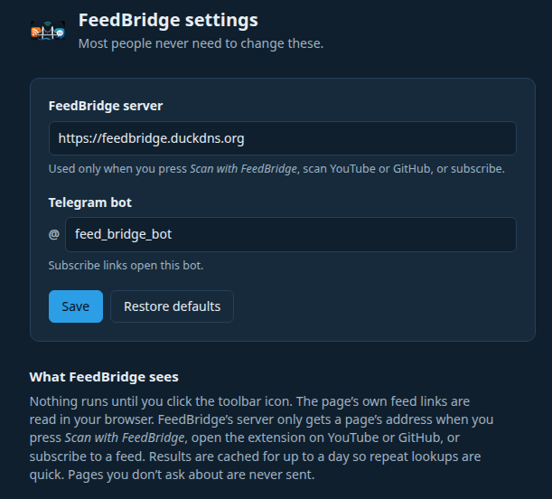

# FeedBridge browser extension

Find the RSS, Atom and JSON feeds on the page you're viewing, and send one to Telegram in two taps. The extension works in Chrome, Edge, Brave and Firefox (Manifest V3, built with [WXT](https://wxt.dev)). It's the browser side of [FeedBridge](../README.md): the bot delivers each new post to your chat or group.

**[Download the latest release →](https://github.com/CrimsonKarma44/FEEDBRIDGE/releases)**

## Using it

### 1. Click the icon to see a page's feeds

Click the FeedBridge icon in the toolbar. The popup lists every feed it found, grouped by type (RSS, Atom, JSON Feed), each with its title and address. The icon's badge shows how many feeds the page has.



Most sites list their feeds in the page itself, and the extension reads them straight from your browser. YouTube channels and GitHub repositories don't, so on those sites the extension asks the FeedBridge server instead. That's why this GitHub example says *Found by FeedBridge*.

Each feed has three buttons:
- **Copy URL** copies the feed's address.
- **Open** shows the raw feed in a new tab.
- **Subscribe** sends it to Telegram (step 2).

### 2. Subscribe through Telegram

Press **Subscribe** and choose where the posts should go:


- **My chat with the bot** opens your private chat with [@feed_bridge_bot](https://t.me/feed_bridge_bot).
- **A group** asks Telegram which group to use. In groups, only admins can confirm.

Telegram opens and the bot asks *"Subscribe this chat to this feed?"*. Tap **Subscribe**, and the bot confirms and posts the latest items. The link works once and expires after 15 minutes. If the FeedBridge server can't be reached, the popup shows the `/addfeed <url>` command to paste into the bot instead.

### 3. Pages that don't list any feeds

If a page has no feed links, the extension doesn't contact anything on its own. It offers a deeper check instead:



**Scan with FeedBridge** sends the page's address to the FeedBridge server. The server checks the site more thoroughly, including common feed locations and the site's homepage. If it still finds nothing, the popup says so:



### 4. Settings

**Settings**, at the bottom of the popup, opens the options page. Most people never need to change anything here.



- **FeedBridge server:** the API the extension talks to. It must use HTTPS. If you change it, the browser asks for permission to reach the new address.
- **Telegram bot:** the bot that Subscribe links open, for anyone running their own FeedBridge.

## Install

The extension isn't in the Chrome Web Store or Firefox Add-ons yet. Download it from [GitHub Releases](https://github.com/CrimsonKarma44/FEEDBRIDGE/releases):

**Chrome, Edge, Brave**
1. Download `feedbridge-extension-<version>-chrome.zip` and unzip it into a folder you'll keep. The browser loads it from there.
2. Open `chrome://extensions` (`edge://extensions` in Edge) and turn on **Developer mode**.
3. Click **Load unpacked** and choose the unzipped folder.
4. Pin FeedBridge from the puzzle-piece menu so the icon stays in the toolbar.

**Firefox (142 or later)**
1. Download `feedbridge-extension-<version>-firefox.zip`.
2. Open `about:debugging#/runtime/this-firefox`, click **Load Temporary Add-on…** and choose the zip.

Firefox removes temporary add-ons when it restarts, unless the release includes a Mozilla-signed `-firefox-signed.xpi`. You can install that one permanently by dragging it onto a Firefox window. The first time you scan with FeedBridge or subscribe, Firefox asks to allow access to `feedbridge.duckdns.org`; choose **Allow**.

## Privacy

- **Nothing runs until you click the icon.** The extension doesn't watch the pages you browse.
- **Feed links are read in your browser.** The page itself is never sent anywhere for that.
- **The FeedBridge server only receives a page's address when you:**
  - press **Scan with FeedBridge**
  - open the extension on YouTube or GitHub
  - subscribe to a feed
- **Server results are cached for up to a day** so repeat lookups are quick.
- **Permissions:** read the current tab when you click the icon (`activeTab`, `scripting`), store your settings (`storage`), and contact `https://feedbridge.duckdns.org` only.

---

## For developers

### How it works

- **No background scanning.** There's no content script on every page. A click grants `activeTab` for that tab, and the popup injects one self-contained function (`utils/scan.ts`) that reads `<link rel="alternate">` tags and resolves relative URLs.
- **Server calls:** the popup calls `GET /v1/detect?url=` on the API's [HTTP gateway](../README.md#http-gateway-browser-extension). It does this automatically on known platforms (`youtube.com`, `youtu.be`, `github.com`) when it already has access, otherwise only after **Scan with FeedBridge**.
- **Subscribe:** calls `POST /v1/link-tokens` and opens `t.me/<bot>?start=add_<token>` (or `?startgroup=`). The bot looks up the token over gRPC and asks the chat to confirm.
- **Badge:** set per tab after a scan. `entrypoints/background.ts` only clears it when the tab navigates.

### Develop

```bash
npm install              # also runs `wxt prepare`
npm run dev              # Chrome with live reload
npm run dev:firefox
npm test                 # Vitest: scan.ts (jsdom), api.ts, links and settings
npm run check            # TypeScript
npm run build            # .output/chrome-mv3
npm run build:firefox    # .output/firefox-mv3
npm run zip              # Chrome zip (zip:firefox adds Firefox + sources)
```

Load a local build:
- **Chrome:** `chrome://extensions` → Developer mode → **Load unpacked** → `.output/chrome-mv3`.
- **Firefox:** `about:debugging#/runtime/this-firefox` → **Load Temporary Add-on** → `.output/firefox-mv3/manifest.json`.

Firefox builds need Firefox 142 or later, because they declare `data_collection_permissions` (`browsingActivity`). Check them with `npx web-ext lint --source-dir .output/firefox-mv3`.

### Release

`.github/workflows/extension-release.yml` builds and publishes a GitHub release when a matching tag is pushed:

```bash
# 1. bump "version" in browser-extension/package.json (e.g. 0.2.0) and commit
# 2. tag that commit and push the tag
git tag extension-v0.2.0
git push origin extension-v0.2.0
```

The workflow:
1. checks that the tag matches `package.json`
2. runs `npm run check` and `npm test`
3. builds the Chrome, Firefox and source zips
4. writes `SHA256SUMS.txt`
5. publishes the release with `RELEASE_NOTES.md`, filling in `{{VERSION}}`

If the repository has the secrets `AMO_JWT_ISSUER` and `AMO_JWT_SECRET`, it also attaches a Mozilla-signed `-firefox-signed.xpi`.

### Layout

```
entrypoints/background.ts   clears the badge on navigation
entrypoints/popup/          scan, list, copy/open/subscribe
entrypoints/options/        server address and bot username
utils/scan.ts               injected <link> reader (must stay self-contained)
utils/api.ts                /v1/detect and /v1/link-tokens client
utils/telegram.ts           deep links and the /addfeed fallback
utils/settings.ts           storage.sync settings and validation
utils/feeds.ts              types, grouping, known platforms
public/icon/                icons cut from docs/images/feedbridge-logo.png
RELEASE_NOTES.md            release notes template
```
