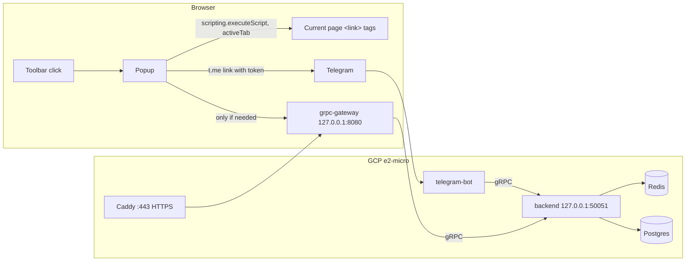

# FeedBridge browser extension — plan

Replaces `.junie/plans/browser-extension-feedbridge.md`. Written 2026-10-31.

## Goal

A Chrome and Firefox extension (Manifest V3) that finds the feeds on the current page **when the user clicks the toolbar icon**, and subscribes one in a few taps through the FeedBridge Telegram bot.

The extension does nothing until it's clicked. That keeps browsers and the server free of background work, keeps the permission prompt small, and means FeedBridge never sees pages the user didn't ask about.

## Decisions

| Topic | Decision |
|---|---|
| Detection trigger | On click only. No content script runs on every page and there's no automatic badge. After a scan, the badge shows that tab's count until it navigates. |
| Backend API | gRPC stays the core contract. A **grpc-gateway** layer, generated from the same `.proto` files, serves HTTP/JSON for the browser. The bot keeps talking gRPC. |
| Telegram subscribe | Short-lived **link token** in Redis → `t.me/feed_bridge_bot?start=add_<token>` → the bot asks the user to confirm → subscribes. Fallback: copy `/addfeed <url>` and open the bot. |
| Storage | Detection results go to **Redis only** (existing TTLs, 64 MB LRU cap). Postgres changes only when someone subscribes. |
| Feed types | Only what `rss_detector` reports: `rss`, `atom`, `json`, `unknown`. No version labels. |
| Platforms in v1 | Telegram only. No Discord or web placeholders. |

## Architecture



## How a click works

1. The user clicks the icon and the popup opens. `activeTab` grants access to this tab only.
2. The popup injects a one-off function (`scripting.executeScript`) that reads `<link rel="alternate">` tags with feed MIME types:
   - `application/rss+xml`
   - `application/atom+xml`
   - `application/feed+json`
   - `application/json` only when the `rel`/`title` marks it as a feed

   Relative `href`s are resolved against `document.baseURI`. Nothing persistent is injected.
3. **Feeds found:** the popup shows them and sets the badge count for that tab.
4. **No feeds found:**
   - On a known platform host (`youtube.com`, `youtu.be`, `github.com`), it calls `GET /v1/detect?url=` straight away. This is part of the same click.
   - Otherwise it shows **Scan with FeedBridge**, and the backend is called only if the user presses it.
5. Each feed row offers **Copy URL**, **Open**, and **Subscribe in Telegram**.
6. **Subscribe:**
   1. `POST /v1/link-tokens {url}` returns `{token}`.
   2. The extension opens `https://t.me/<bot>?start=add_<token>`, or `?startgroup=add_<token>` if the user picked "a group".
   3. If the backend is unreachable, it copies `/addfeed <url>` and opens `https://t.me/<bot>` instead.
7. A small background script clears the tab's badge when the tab navigates (`tabs.onUpdated`, status `loading`). It does no other work.

## Backend changes (`backend/`)

**Proto:** new `proto/extension.proto`:

```proto
service ExtensionService {
  rpc Detect(DetectRequest) returns (DetectResponse) {
    option (google.api.http) = { get: "/v1/detect" };
  }
  rpc CreateLinkToken(CreateLinkTokenRequest) returns (LinkToken) {
    option (google.api.http) = { post: "/v1/link-tokens" body: "*" };
  }
  // gRPC only (no HTTP route) — called by the bot.
  rpc ResolveLinkToken(ResolveLinkTokenRequest) returns (ResolveLinkTokenResponse);
}
// DetectResponse { string url; repeated Feed feeds; }  Feed { url, title, type, source }
// ResolveLinkTokenRequest { string token; bool consume; }
```

- **Third-party protos:** vendor `google/api/annotations.proto` and `http.proto` into `proto/third_party/`.
- **Makefile:** extend `make proto` with `--grpc-gateway_out` (plugin `protoc-gen-grpc-gateway`) and the new file.

**Shared detection helper:**
- Move the cache, singleflight, and save-to-Redis logic out of `SetUrlHandler.SetUrl` (`handlers/setUrl.go:36-68`) into `detectCached(ctx, redis, yt, url)`, which wraps `resolveFeeds` (`handlers/detect.go:69`) and the existing `loadCachedFeedLinks`/`storeCachedFeedLinks` in `handlers/cache.go`.
- `SetUrl` keeps its Postgres `AddLink`. `Detect` never writes to Postgres.

**`handlers/extension.go`:**
- `Detect`:
  - accepts `http`/`https` only
  - returns NotFound when no feeds are found, using the existing `detectErrorStatus`
  - fills in `title`, `type` and `source` from `rssdetector.FeedLink`
- `CreateLinkToken`:
  - checks the URL with the same rules the bot uses (`telegram-bot/handlers/input.go` `NormalizeURL` logic)
  - creates the token: 9 bytes from `crypto/rand`, base64url-encoded, so 12 characters (`add_` + 12 = 16, well under Telegram's 64)
  - stores `fb:linktoken:<token>` → URL with a 15-minute TTL
- `ResolveLinkToken`: `GET` when `consume=false` (so the confirm message can show the URL), `GETDEL` when `consume=true`. NotFound when the token has expired.
- **Redis helper:** add `GetDel` to `config/redis_db.go`. go-redis supports it, and Redis 7 on Ubuntu 24.04 does too.

**HTTP gateway in `main.go`:**
- A new optional `HTTP_LISTEN_ADDR` variable. When it's empty the gateway is off, so local development and the bot are unchanged.
- Uses `runtime.NewServeMux()` with `RegisterExtensionServiceHandlerFromEndpoint` dialing the local gRPC address, so the existing logging and recovery interceptors still apply.
- Wraps the mux in middleware:
  - **Rate limit:** per client IP with `golang.org/x/time/rate`, for example 30 requests/min with a burst of 10. The IP comes from `X-Forwarded-For` only when the request arrives from loopback (Caddy).
  - **Body limit:** 4 KB.
  - **Health:** `/healthz`.
- Shuts down gracefully together with the gRPC server.
- No CORS headers are needed, because extension pages that have host permissions bypass CORS in both browsers.

**Tests:**
- `handlers/extension_test.go`, using bufconn like `subscription_test.go`: Detect cache hit and miss (no Postgres row is written), token create → peek → consume → second consume returns NotFound, token expiry.
- A gateway smoke test with `httptest`: `GET /v1/detect`, `POST /v1/link-tokens`, and a 429 when the rate limit is hit.

## Bot changes (`telegram-bot/`)

- **`grpcclient/client.go`:** `ResolveLinkToken(ctx, token, consume)`.
- **`handlers/feed.go`:** move the code after `NormalizeURL` in `AddFeed` (lines 64–102) into `subscribeURL(c, target)`. `AddFeed` and the new flow both call it.
- **`handlers/entryConfig.go` `Start`:** if `c.Message().Payload` starts with `add_`:
  1. Peek the token (`consume=false`).
  2. Reply "Subscribe this chat to `<url>`?" with **Subscribe** (`\ftok_add|<token>`, about 25 bytes, under the 64-byte callback limit) and **Cancel**.
  3. If the token has expired, reply: "That link expired. Send /addfeed <url> instead."
- **Subscribe button:**
  1. `adminGate`, so in groups only admins can confirm.
  2. Consume the token (`consume=true`).
  3. Call `subscribeURL`.
  4. Edit the message to show the result.
- Register `\ftok_add` and `\ftok_cancel` in `main.go`. Mention the extension in the `/start` text.
- **Tests:** payload parsing (`add_` prefix, bad and empty tokens) and the confirm/cancel handlers, using the fakes in the existing handler tests.

## Deploy (`deploy/`, VM)

- **Hostname:** `feedbridge.duckdns.org` (DuckDNS, pointing at `35.239.193.103`) for development and testing. Move to your own domain before the store release, since the hostname is built into the extension's host permissions.
- **Keep the IP current:** root cron on the VM, with the token in `/etc/feedbridge/duckdns.env` (mode 600, never in the repo):
  ```
  */5 * * * * . /etc/feedbridge/duckdns.env && curl -fsS "https://www.duckdns.org/update?domains=feedbridge&token=$DUCKDNS_TOKEN&ip=" >/dev/null
  ```
- **Caddy** on the VM, about 30 MB of RAM. `/etc/caddy/Caddyfile`:
  ```
  feedbridge.duckdns.org {
    reverse_proxy 127.0.0.1:8080
  }
  ```
  Caddy gets the TLS certificate automatically.
- **Firewall:** open TCP 80 (certificate challenge and redirect) and 443 in the GCP firewall and UFW. 50051, 8080, 5432 and 6379 stay closed.
- **Env:** add `HTTP_LISTEN_ADDR=127.0.0.1:8080` to `deploy/env/backend.env.example` and `/etc/feedbridge/backend.env`.
- **Setup script:** add Caddy and the firewall rules to `setup-server.sh` (keep it safe to re-run). Document it in the README deploy section.
- **Optional cleanup:** a nightly SQL step in `backup-db.sh` that deletes `link_repositories` rows no subscription references. Today's `/addfeed` and `GetFeed` still save rows there.

## Extension (`browser-extension/`)

WXT with TypeScript and **plain DOM code, no UI framework**. The popup is a list and a few buttons.

```
browser-extension/
├── wxt.config.ts          # Chrome + Firefox MV3 targets, manifest fields
├── package.json, tsconfig.json
├── entrypoints/
│   ├── background.ts      # only clears the badge on navigation
│   ├── popup/             # index.html, main.ts, style.css
│   └── options/           # API URL, bot username
├── utils/
│   ├── scan.ts            # injected function: <link> tags → DetectedFeed[]
│   ├── api.ts             # detect(), createLinkToken(), with timeouts
│   ├── telegram.ts        # deep-link + fallback builder
│   └── settings.ts        # storage.sync wrapper
└── tests/                 # Vitest: scan.ts (jsdom), api.ts, telegram.ts
```

- **Permissions:** `activeTab`, `scripting`, `storage`.
- **Host permissions:** only `https://feedbridge.duckdns.org/*`. A custom API URL set on the options page is requested at runtime through `optional_host_permissions`.
- **Popup:**
  - sections for RSS, Atom, JSON and Other; only non-empty ones are shown
  - each row has the title, a shortened URL, Copy (shows "Copied"), Open, and Subscribe
  - the Subscribe target can be "this chat with the bot" or "a group"
  - an empty state with **Scan with FeedBridge**
  - an error state when the backend is unreachable, which says that page-only detection still works
- **Firefox:** use WXT's Firefox MV3 build. Firefox users have to approve the host permission on first use, so the popup asks for it when it's missing.

## Delivery steps

Each step can ship and be tested on its own.

1. ✅ **Backend RPCs** (done 2026-10-31): the `extension.proto` service, `detectCached` refactor, the link-token Redis store, and tests. gRPC only.
2. **HTTP gateway:** the grpc-gateway codegen, the `HTTP_LISTEN_ADDR` listener, rate limiting, and tests.
3. **Bot:** the `start=add_<token>` confirm flow, the `subscribeURL` refactor, and tests.
4. **Deploy:** Caddy, firewall, env, README; ship the binaries with `deploy/deploy-*.sh`.
5. **Extension:** scan, popup, subscribe, options, and Vitest tests. Load it unpacked in Chrome and Firefox.
6. **Release:**
   - icons and store listings
   - a privacy policy: the URL is sent only when the user scans or subscribes; nothing is stored beyond a 24-hour cache
   - update README and CLAUDE.md

## Verification

- **Tests:** `go test ./...` in `backend/` and `telegram-bot/`, and `npm test` in `browser-extension/`.
- **Detect:** `curl 'https://feedbridge.duckdns.org/v1/detect?url=https://www.youtube.com/@<channel>'` returns one Atom feed. Repeating it logs a cache hit, and `SELECT count(*) FROM link_repositories` doesn't change.
- **Tokens:** `curl -X POST https://feedbridge.duckdns.org/v1/link-tokens -d '{"url":"https://go.dev/blog/feed.atom"}'` returns a token. Opening `t.me/feed_bridge_bot?start=add_<token>` shows the confirm message, Subscribe adds the feed (check `/listfeed`), and opening the same link again says it expired.
- **Rate limit:** more than 30 requests a minute from one IP get HTTP 429.
- **Extension in Chrome and Firefox:**
  - Browsing pages makes no network requests and doesn't change the badge.
  - Clicking on a blog shows its feeds and sets the badge.
  - Clicking on a page with no feeds makes no backend call until **Scan** is pressed.
  - With the backend stopped, Subscribe falls back to copying `/addfeed`.

## Open items

- The production domain to replace `feedbridge.duckdns.org` before the store release.
- Whether to add the `link_repositories` cleanup job now or later.
